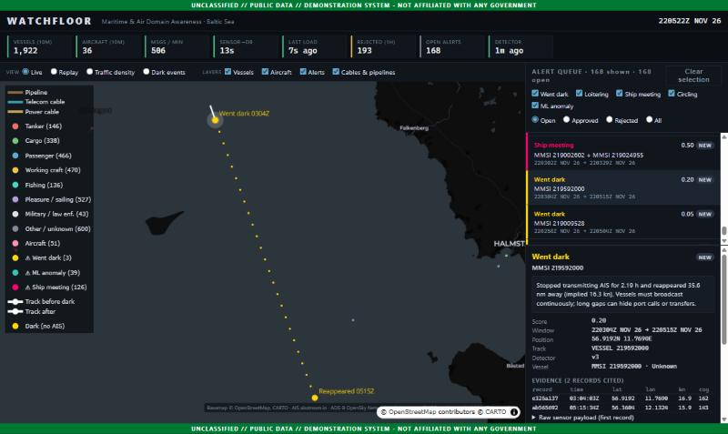

# Watchfloor

**An AI-assisted maritime and air domain awareness workbench.** It streams live aircraft (ADS-B)
and ship (AIS) positions through Kafka into Snowflake, flags suspicious behaviour such as vessels
going dark, loitering, ship-to-ship meetings and aircraft orbits, and uses an LLM analyst agent to
draft cited intelligence-style reports that a human must approve.

> Unclassified. Uses only public data feeds and textbook methods. See [docs/DESIGN.md](docs/DESIGN.md).

[](https://github.com/triston-williamson/AI-analyst-workbench-for-air-and-sea-monitoring/actions/workflows/ci.yml)



*Live Baltic data. A vessel stops transmitting AIS at 0304Z and reappears 35.6 nm away at
0515Z (dotted segment). The analyst sees why it was flagged, the cited sensor records, and the
audit history, then approves or rejects it.*

## Why

In the Baltic Sea, AIS gaps and ship-to-ship transfers are linked to sanctions evasion and to
damage to undersea infrastructure. Analysts can't watch thousands of tracks at once. Watchfloor
narrows the picture to the few that matter and explains why, with every claim tied to source data.

## Architecture

```
OpenSky (ADS-B) ─┐                                  ┌─► Detection ─► Alerts ─► LLM analyst ─► Human approval
                 ├─► Kafka ─► Snowflake (RAW/CORE/OPS) ┤                         (cited, grounded)
aisstream (AIS) ─┘     └─► dead-letter (rejected input) └─► Dash live map
                                     every step ─► hash-chained audit log
```

| | |
|---|---|
| Streaming | Kafka (KRaft) in Docker |
| Warehouse | Snowflake |
| Validation | Pydantic v2: all feed data is treated as untrusted |
| Detection | Rule engine (gap, loiter, rendezvous, orbit) + Isolation Forest anomaly scoring |
| AI | LLM agent with read-only tools, citation grounding check, human-in-the-loop |
| UI | Plotly Dash |
| Quality | pytest, ruff, GitHub Actions CI |

## Status

| Phase | Scope | |
|---|---|---|
| 1 | Kafka ingest (ADS-B + AIS), Snowflake sink, live map | ✅ built |
| 2 | Detection: AIS gaps, loitering, ship-to-ship rendezvous, aircraft orbits, ML anomaly scoring, vessel-type context, alerts on map | ✅ built |
| 3 | Analyst agent, OFAC sanctions screening, grounding loop | 📋 |
| 4 | Operator console: alert queue, evidence trails, approve/reject with audit, replay, heatmaps, system health | ✅ built (metrics page 📋) |

Requirements and how each is verified are listed in [DESIGN.md §4](docs/DESIGN.md#4-requirements-and-traceability).

## Operator console

| Feature | What it shows |
|---|---|
| **Alert queue** | Alerts ranked by score, filterable by rule and review status. Click to fly the map to it. |
| **Evidence trails** | *Went dark:* track, dotted gap, "went dark" / "reappeared" times. *Ship meeting:* both tracks converging. *Circling:* the orbit. Click any ship for its last 2 h. |
| **Alert detail** | Plain-language reason, vessel identity (name, type, IMO), the cited sensor records with raw payload, audit history. |
| **Approve / Reject** | Analyst decision with a note, written to `OPS.ALERTS` and the hash-chained audit log; can be reopened. |
| **Vessel display** | Colour by ship type (tanker, cargo, passenger, working craft, ...) with heading leaders whose length shows speed; stationary vessels have none. |
| **Replay** | Scrub or play back the collected history in 10-minute steps. |
| **Heatmaps** | Traffic density (shipping lanes) and where vessels went dark. |
| **Undersea infrastructure** | Pipelines (incl. Nord Stream 1/2, Balticconnector) and power/telecom cables from EMODnet. |
| **System health** | Live tracks, messages/min, sensor-to-warehouse latency, data freshness, rejected records, detector heartbeat. |

Times are shown in Zulu (UTC) date-time groups, e.g. `221432Z NOV 26`.

## Quick start (Windows / PowerShell)

Prerequisites: Python 3.11+, Docker Desktop, a free [Snowflake trial](https://signup.snowflake.com/),
and a free [aisstream.io](https://aisstream.io) API key.

```powershell
py -m venv .venv
.\.venv\Scripts\Activate.ps1
pip install -e ".[dev]"
copy .env.example .env      # then fill in your keys
docker compose up -d        # Kafka on :9092, Kafka UI on http://localhost:8080
python -m watchfloor.load.setup_snowflake   # creates warehouse, role, DB, tables; re-run after pulling new migrations
```

Then run each piece in its own terminal (or use **Run and Debug → "Run full pipeline"** in VS Code):

```powershell
python -m watchfloor.ingest.adsb_producer   # aircraft -> Kafka
python -m watchfloor.ingest.ais_producer    # ships -> Kafka
python -m watchfloor.load.snowflake_sink    # Kafka -> Snowflake
python -m watchfloor.detect.runner          # detectors every 5 min -> OPS.ALERTS
python -m watchfloor.dashboard.app          # http://127.0.0.1:8050
```

Try the detectors without writing anything: `python -m watchfloor.detect.runner --once --dry-run`.
Rules such as loitering (3 h) and going dark (2 h) need a few hours of collected data to fire.

Run the tests with `pytest`. Change the area of interest with `AOI_BBOX` in `.env`.

## Secrets handling

- API keys and passwords live only in `.env`, which is git-ignored. `.env.example` holds blank
  placeholders only.
- Secrets load as Pydantic `SecretStr`, so they print as `**********` in logs and tracebacks.
- A pre-commit hook ([.githooks/pre-commit](.githooks/pre-commit)) blocks secret files and runs
  [gitleaks](https://github.com/gitleaks/gitleaks) on staged changes. Turn it on after cloning:
  `git config core.hooksPath .githooks`
- CI scans the full git history with gitleaks on every push.

## Repository layout

```
src/watchfloor/
  ingest/      OpenSky + aisstream producers, validation, dead-letter routing
  load/        Kafka -> Snowflake sink, connection, one-time setup
  sql/         Snowflake DDL and versioned migrations (RAW / CORE / OPS schemas)
  detect/      rules (gap, loiter, rendezvous, orbit), ML scoring, port zones, runner
  agent/       LLM analyst (Phase 3)
  guardrails/  hash-chained audit log, citation grounding checker
  dashboard/   operator console: app (layout/callbacks), data (queries), figures (map drawing)
docs/DESIGN.md requirements, architecture, Responsible AI mapping, risks
```

## Data sources

- [OpenSky Network](https://opensky-network.org): ADS-B state vectors (non-commercial use)
- [aisstream.io](https://aisstream.io): live AIS over websocket
- [OFAC SDN list](https://sanctionslist.ofac.treas.gov): sanctions screening (Phase 3)
- [EMODnet Human Activities](https://emodnet.ec.europa.eu/en/human-activities): pipelines and
  cables (EU open data). Refresh with `python scripts/fetch_overlays.py`.
